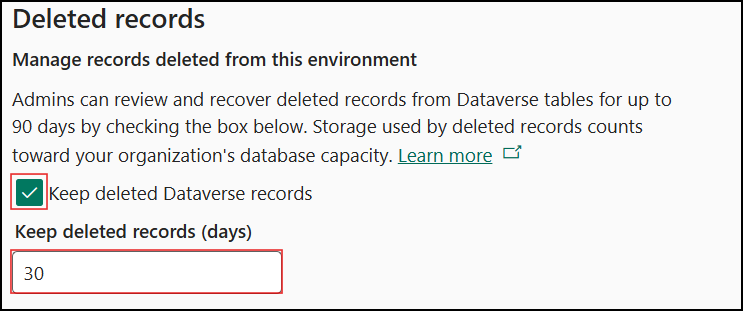
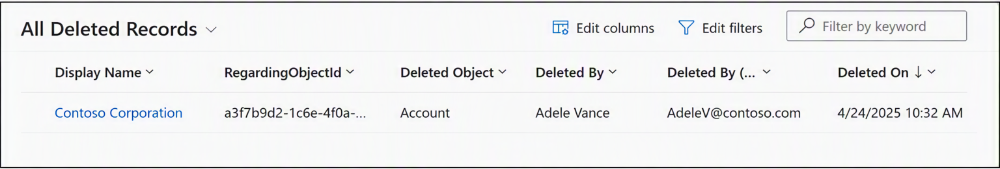

I accidentally deleted a record from a CRM environment. Luckily, it was only a Sandbox environment. However, I still needed that record because it contained valuable data and relationships that were useful for testing my feature. I went on searching for a solution to restore deleted Dataverse records.

While searching for a solution, I came across an out-of-the-box (OOTB) approach, which is the **Recycle Bin** feature available in Dataverse.

## Enable the Dataverse Recycle Bin Option

To enable the Recycle Bin feature, configure the setting in the **Power Platform Admin Center**.

- Sign in to the Power Platform Admin Center as a **Dynamics 365 Administrator** or **Microsoft Power Platform Administrator**.
- Navigate to **Manage → Environments** and open the desired environment.
- Go to **Settings → Product → Features**.



- Scroll down to the **Deleted records** section and enable **Keep deleted Dataverse records**.
- In the **Keep deleted records (days)** field, enter a value between **1 and 90** days.
- Select **Save**.
- The configuration may take approximately **30 minutes** to become effective across the environment.

## View and Restore Deleted Records

To view and restore deleted records:

- Navigate to the **Power Platform Admin Center**.
- Select **Environments** and open the required environment.
- Go to **Settings → Data Management → Deleted Records**.



- View deleted records across all supported tables.
- Select one or more records that you want to restore and click **Restore** from the command bar.
- Select **OK** to confirm the restore operation.

## Restore Deleted Records Using Code

Deleted records can also be restored programmatically by using either **JavaScript** or **C#**.

> **_Prerequisite:_** _The Recycle Bin feature must be enabled before deleted records can be retrieved and restored._

### Restore Deleted Records Using JavaScript:

To restore a deleted record, we need to perform two steps:

1. Retrieve the deleted records.
2. Restore the required record.

Deleted records can be retrieved by using either query parameters or Fetch XML filters.

The following code retrieves deleted records:
<script src="https://gist.github.com/tamilarasu-arunachalam/f597e5e7d96df90251bb33e56e9fb5c0.js?file=getDeletedRecords.js"></script>

The following code restores a deleted record:

<script src="https://gist.github.com/tamilarasu-arunachalam/f597e5e7d96df90251bb33e56e9fb5c0.js?file=restoreDeletedRecords.js"></script>

### Restore Deleted Dataverse Records Using C#

- The same approach can be implemented in C#. In the example below, the plugin restores deleted **Account** records whose account number starts with **“ABC”**.
- After retrieving the required records, we execute the **Restore** request to recover them.

<script src="https://gist.github.com/tamilarasu-arunachalam/f597e5e7d96df90251bb33e56e9fb5c0.js?file=RestoreDeletedABCAccountsPlugin.js"></script>

We are using a **QueryExpression** to select fields and apply filters while retrieving deleted records. If you are more comfortable working with FetchXML, you can use that instead.

```csharp
string fetchXml = @"
<fetch top='50' datasource='bin'>
  <entity name='account'>
    <attribute name='name' />
    <attribute name='accountnumber' />
    <filter>
      <condition attribute='accountnumber'
                 operator='begin-with'
                 value='ABC%' />
    </filter>
  </entity>
</fetch>";

EntityCollection deletedRecords = service.RetrieveMultiple(
    new FetchExpression(fetchXml));
```

## Limitations:

- Deleted records can be restored only if the Recycle Bin feature was enabled before the records were deleted.
- This feature is not supported in **Trial**, **Default**, or **Developer** environments.
- Some tables do not support record restoration. Refer to the Microsoft documentation for the complete list of supported and unsupported tables.
- **Virtual Tables**, **Elastic Tables**, tables that store **solution components**, and tables with more than **600 attributes** are not supported by the restore functionality.

## References:

- [Restore deleted Microsoft Dataverse table records — Power Platform — Microsoft Learn](https://learn.microsoft.com/en-us/power-platform/admin/restore-deleted-table-records)
- [Restore deleted records with code — Power Apps — Microsoft Learn](https://learn.microsoft.com/en-us/power-apps/developer/data-platform/restore-deleted-records?tabs=sdk#detect-which-tables-arent-enabled-for-deleted-record-keeping)
