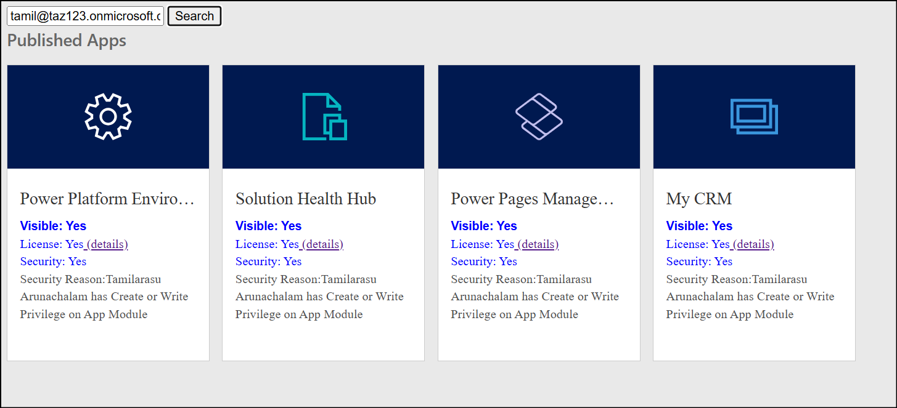
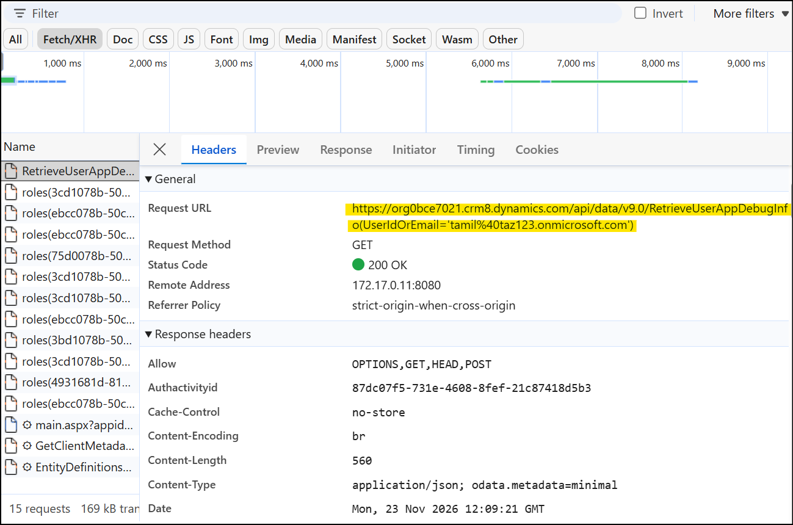
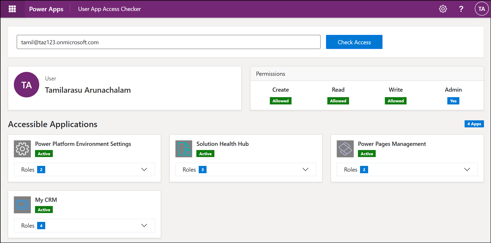
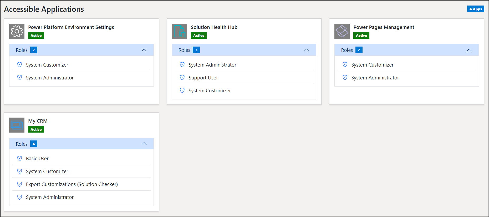

Some days back, a user reported a Dynamics 365 app access issue where they could no longer see a model-driven app in the app drawer. I checked and confirmed that, somehow, they had lost access. After granting access again, the issue was resolved.

Even though it was a simple issue, it still took around 10–15 minutes to check the user’s roles and the app roles.

Since this is a common Dynamics 365 app visibility issues administrators encounter, I checked whether there was any out-of-the-box tool available to make this easier. Luckily, there is a web resource of name **Dynamics 365 App Access Checker** from Microsoft within Dynamics 365 CE where you can check a user’s app access using their email address. I wasn’t aware that this existed. Below is the link for it; just replace the org name with yours.

`https://<org-name>.crm.dynamics.com/WebResources/msdyn_AppAccessChecker.html`

Though the web resource looks a bit old, it is very useful when switching between apps and users to troubleshoot access issues.

After digging deeper, Dynamics 365 App Access Checker relies on an internal Dynamics 365 Web API that accepts a user’s email address as a parameter. Without wasting any time, I tested it in the browser and was able to get a response.

I then built a custom Dynamics 365 App Access Checker web resource with a better design and as many insights as possible. It’s an HTML web resource with a clean UI and insights such as the roles assigned to the user in each app.

Even though it is a web resource, it looks like a model-driven app. If it were built as an app, users would need access to that app as well.

Below is the full source code for user app access checker web resource.

\

#### References:

- [Model App Access Checker for Dataverse — Richard A. Wilson](https://www.richardawilson.com/blog/model-app-access-checker-for-dataverse/)
- [Dataverse Impersonation with JavaScript Web API](https://tamilarasu.blog/dataverse-impersonation-with-web-api-d365-crm.html)
- [How to Translate Metadata and Web Resources in Dynamics 365 CE](https://tamilarasu.blog/translate-metadata-and-web-resources-d365-crm.html)
